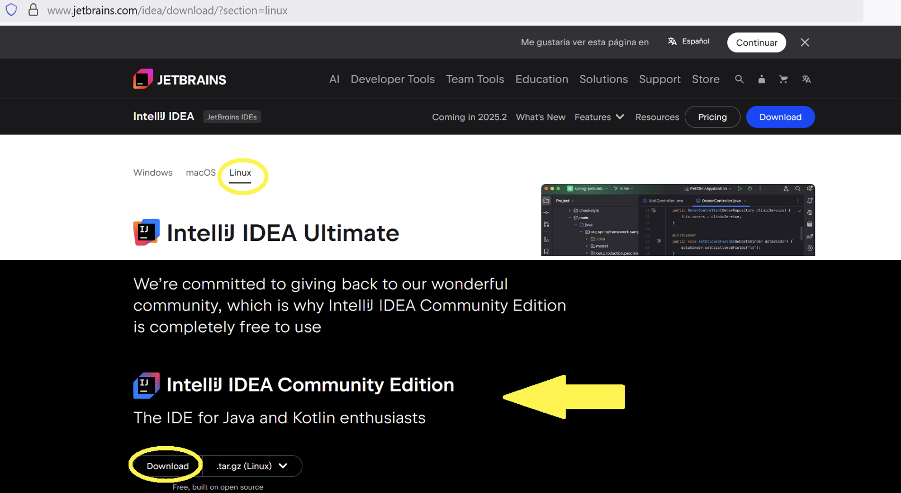
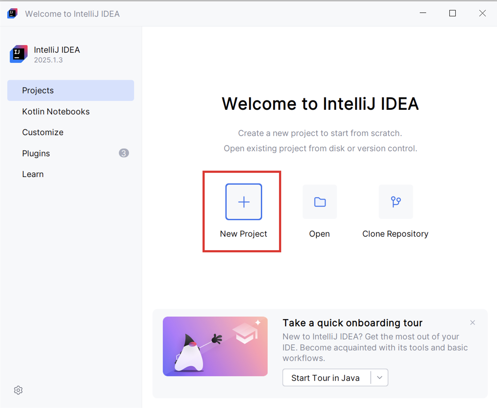
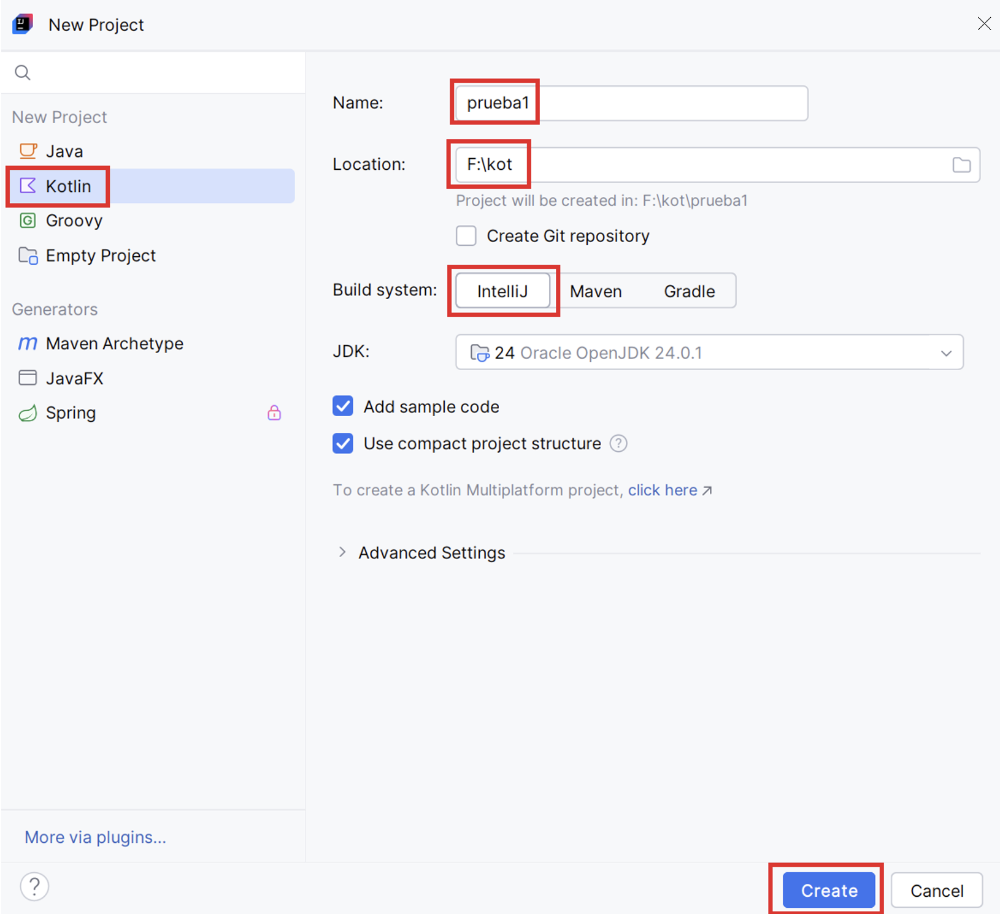
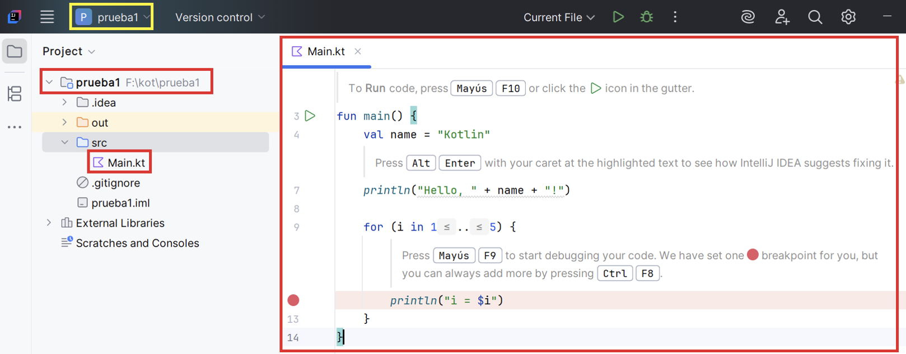
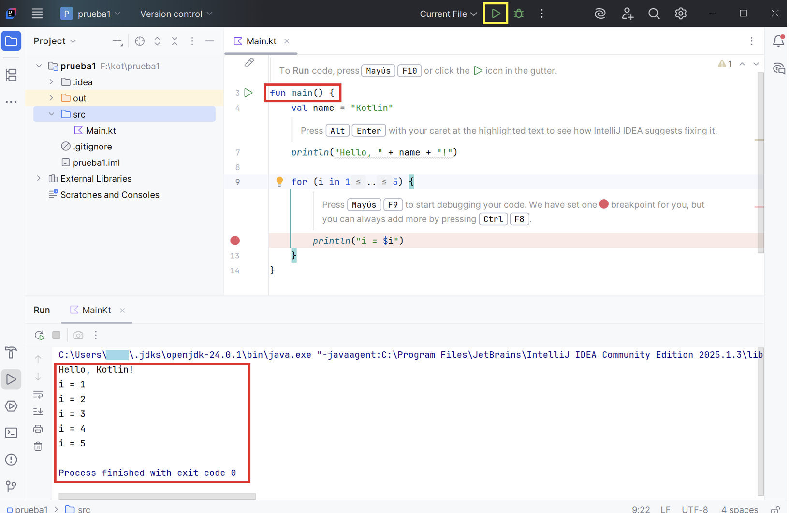
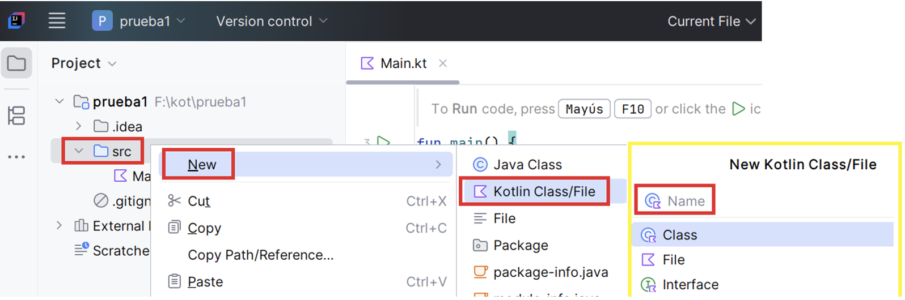
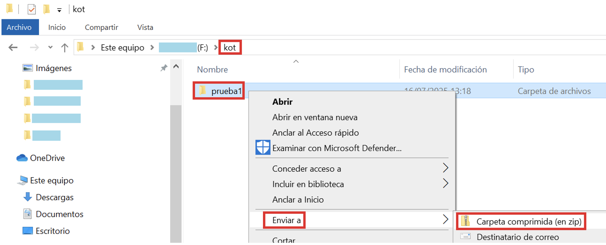

# UD1 — Introducción a Kotlin

## Objetivos de la Unidad

| # | Objetivo |
| :---: | :--- |
| 1 | Configurar el entorno de desarrollo IntelliJ IDEA para proyectos Kotlin |
| 2 | Comprender las diferencias clave entre Kotlin y Java y sus ventajas |
| 3 | Declarar y utilizar variables, tipos de datos y estructuras de control en Kotlin |
| 4 | Definir y usar funciones, clases y colecciones propias de Kotlin |
| 5 | Aplicar los principios de la POO (herencia, interfaces, data classes) en Kotlin |

---

## Guía de Uso

A lo largo de la unidad encontrarás tres tipos de bloques que estructuran el aprendizaje:

!!! success "🔍 Ejecutar y Analizar"
    Contienen fragmentos de código que deben ser ejecutados y comprendidos en detalle. El objetivo es observar su funcionamiento y salida.

!!! warning "🎯 Práctica para Aplicar"
    Indican una tarea de programación que debes realizar para afianzar los conceptos aprendidos.

!!! danger "📁 Entrega"
    Marcan los puntos de entrega del trabajo, que serán revisados y calificados por el profesor.

---

## 1. Introducción

En el módulo de Programación de 1º DAM trabajamos con Java, un lenguaje orientado a objetos ampliamente utilizado en el desarrollo de aplicaciones empresariales. Aprendimos conceptos como estructuras de control, clases, objetos y herencia.

En Acceso a Datos continuamos aplicando esos mismos conceptos usando **Kotlin**, un lenguaje moderno, conciso y seguro. Kotlin funciona sobre la máquina virtual de Java (JVM), fue desarrollado por JetBrains (los creadores de IntelliJ IDEA) y es **100% interoperable con Java**.

Sus principales usos son: aplicaciones Android, aplicaciones de escritorio (con Swing, JavaFX o Compose Desktop), backends web (con Ktor o Spring) y desarrollo multiplataforma (Kotlin Multiplatform).

## 2. Instalación de IntelliJ Community

En este curso utilizaremos IntelliJ IDEA en su versión **Community** (gratuita). Puedes descargarlo desde:

👉 [https://www.jetbrains.com/idea/download/](https://www.jetbrains.com/idea/download/)

Selecciona el instalador correspondiente a tu sistema operativo.

## 3. Proyectos

Antes de empezar hay que decidir cómo organizar el trabajo. En los ejemplos de estos materiales se ha creado una carpeta `kot` donde se guardan los distintos proyectos. También puedes configurar el entorno a tu gusto desde el menú de ajustes (icono de rueda dentada, esquina inferior izquierda).

### 3.1. Creación del proyecto

- Abre IntelliJ y, en la ventana inicial, haz clic en **New Project**.

- Rellena los parámetros del proyecto:
    - Selecciona **Kotlin** en la columna izquierda.
    - Indica nombre y ubicación del proyecto.
    - Comprueba que el sistema de construcción es **IntelliJ**.

- Haz clic en **Create**.

El nuevo proyecto (`prueba1`) se abrirá en una ventana nueva con un pequeño programa de ejemplo.

### 3.2. Ejecución de la aplicación

Haz clic en el icono **Play** ▶. El proyecto debe tener al menos una función `main`. Kotlin usa la palabra reservada `fun` para declararla. El resultado aparece en la consola inferior.

### 3.3. Estructura de carpetas

Al igual que en Java, los archivos fuente deben estar en la carpeta **src**. Para crear un nuevo archivo Kotlin: clic derecho sobre `src` → **New** → **Kotlin File/Class** → indica el nombre.

### 3.4. Compartir proyectos

Para entregar un proyecto (tarea, copia de seguridad, etc.) localiza la carpeta del proyecto con el explorador del sistema operativo y comprímela en un `.zip`.

