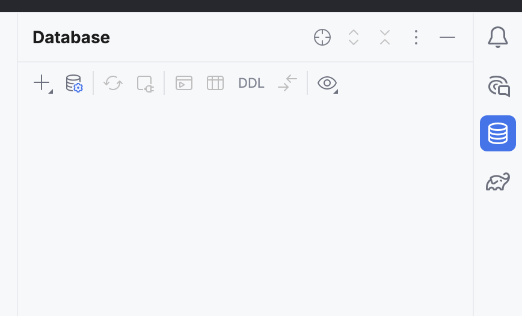
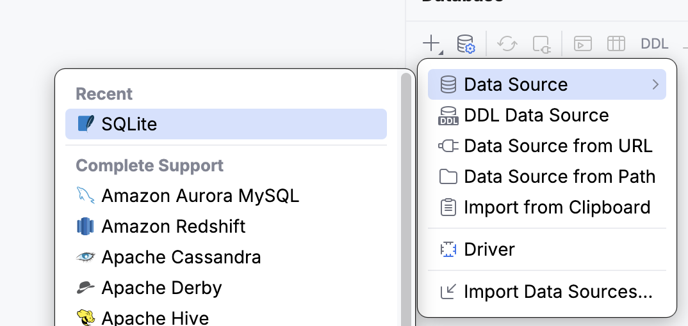
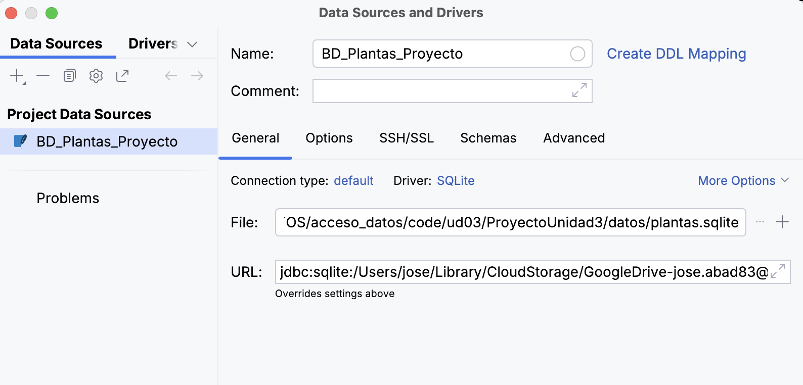
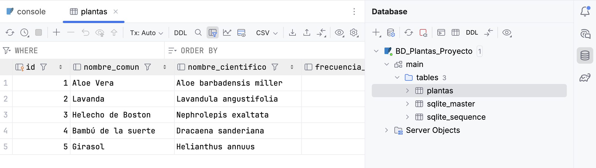

# UD3 — Persistencia en Bases de Datos Relacionales

!!! abstract "Resultado de Aprendizaje"
    - **RA2** - Desarrolla aplicaciones que gestionan información almacenada en bases de datos relacionales, manteniendo la integridad y consistencia de los datos.
    - **RA4** - Desarrolla aplicaciones que gestionan la información almacenada en bases de datos objeto relacionales y orientadas a objetos valorando sus características y utilizando los mecanismos de acceso incorporados.

## Objetivos de la Unidad

| # | Objetivo |
| :---: | :--- |
| 1 | Comprender el modelo relacional y los fundamentos del lenguaje SQL (CRUD) |
| 2 | Configurar la conexión a una base de datos desde Kotlin mediante JDBC |
| 3 | Ejecutar operaciones CRUD utilizando `PreparedStatement` de forma segura |
| 4 | Implementar el patrón DAO para separar la lógica de acceso a datos |
| 5 | Gestionar transacciones para garantizar la integridad de los datos |
| 6 | Migrar la aplicación entre distintos SGBD (SQLite → MySQL/PostgreSQL) |

---

## Guía de Uso

Estos apuntes están diseñados para un aprendizaje práctico. A lo largo de la unidad se aplicarán los conceptos teóricos para construir, paso a paso, una aplicación completa de gestión de datos. La temática es de libre elección, pero los pasos serán comunes.

!!! success "🔍 Ejecutar y Analizar"
    Contienen fragmentos de código que deben ser ejecutados y comprendidos en detalle. El objetivo es observar su funcionamiento y salida.

!!! warning "🎯 Práctica para Aplicar"
    Indican la necesidad de programar y aplicar los conceptos aprendidos para avanzar en el desarrollo del proyecto personal.

!!! danger "📁 Entrega"
    Marcan los puntos de entrega del trabajo, que serán revisados y calificados por el profesor.

---

## Fundamentos de las Bases de Datos Relacionales

En esta primera sección, sentaremos las bases teóricas sobre las bases de datos relacionales y prepararemos el entorno de trabajo inicial para nuestro proyecto.

### Introducción a las Bases de Datos Relacionales

Las bases de datos relacionales son esenciales en el desarrollo de aplicaciones modernas. Su integración con una aplicación requiere realizar una  **conexión** al sistema gestor de base de datos (SGBD) desde el lenguaje de programación.

Este tema se centra en cómo realizar esa conexión, cómo trabajar con datos mediante sentencias SQL y cómo aplicar buenas prácticas, como el cierre de recursos, el uso de transacciones y procedimientos almacenados.

Una **base de datos relacional** es un sistema de almacenamiento de información que **organiza los datos en tablas**. Cada tabla representa una entidad (por ejemplo, clientes, productos, facturas) y está compuestas por filas y columnas, donde cada fila representa un registro único y cada columna contiene un atributo específico de ese registro.

Ejemplo de tabla `clientes`:

| id_cliente | nombre   | ciudad     |
|------------|----------|------------|
| 1          | Pol      | Castellón  |
| 2          | Eli      | Valencia   |

La integridad y las relaciones entre tablas se gestionan mediante claves:

* **Clave Primaria (Primary Key, PK)**: Una o más columnas que identifican de forma única cada registro de una tabla.
* **Clave Foránea (Foreign Key, FK)**: Una columna que referencia la clave primaria de otra tabla, estableciendo así una relación entre ambas.

Ejemplo de tabla `facturas`:

| id_factura | id_cliente | fecha     |
|------------|------------|------------|
| 1          | 1          | 2025-09-18  |
| 2          | 1          | 2025-09-18   |

La interacción con estas bases de datos se realiza a través del lenguaje **SQL (Structured Query Language)**, que permite ejecutar las operaciones **CRUD**:

* **C**reate (Crear): `INSERT`.
* **R**ead (Leer): `SELECT`.
* **U**pdate (Actualizar): `UPDATE`.
* **D**elete (Borrar): `DELETE`.

Un ejemplo sencillo de consulta podría ser:

```sql
    SELECT nombre FROM clientes WHERE ciudad = 'Valencia';
```

### Tipos de Gestores de Bases de Datos (SGBD)

Para conectar una aplicación a una base de datos, es esencial conocer el tipo de SGBD, ya que cada uno requiere un conector (driver) específico.

1. **Gestores Embebidos (SQLite, H2, Derby)**:
    * Bases de datos ligeras almacenadas en un único fichero local. No requieren un servicio de servidor independiente.
    * Ideales para aplicaciones de escritorio, móviles, prototipos o pruebas.

2. **Gestores Cliente-Servidor (PostgreSQL, MySQL, Oracle)**:
    * Sistemas robustos que se ejecutan como un servicio en un servidor, permitiendo múltiples conexiones concurrentes.
    * Son el estándar en entornos empresariales y aplicaciones web por su escalabilidad y seguridad.

!!! example "Autoevaluación"

    **Pregunta 1: ¿Cuál de las siguientes URLs JDBC es la correcta para conectarse a una base de datos SQLite llamada `plantas.sqlite` ubicada en la carpeta `datos` del proyecto?**

    A) `"jdbc:sqlite://localhost:3306/datos/plantas.sqlite"`

    B) `"jdbc:sqlite:datos/plantas.sqlite"`

    C) `"sqlite:datos/plantas.sqlite"`

    D) `"jdbc:sqlite://datos/plantas.sqlite:3306"`

    ??? quote "Solución"
        ❌ A) Esa URL mezcla la sintaxis de MySQL (con host y puerto) con SQLite. SQLite es una base de datos embebida: no necesita host ni puerto, ya que accede directamente a un fichero local.

        ✅ B) El formato correcto para SQLite es `jdbc:sqlite:<ruta_al_fichero>`. La ruta puede ser relativa (desde la raíz del proyecto) o absoluta.

        ❌ C) Falta el prefijo `jdbc:`. Sin él, el `DriverManager` no puede identificar el driver a utilizar y lanzará una `SQLException`.

        ❌ D) Añadir `//` y un puerto `:3306` es la sintaxis de un SGBD cliente-servidor. SQLite no usa red ni puertos.

    **Pregunta 2: ¿Cuál de las siguientes afirmaciones describe correctamente la diferencia principal entre un SGBD embebido (como SQLite) y uno cliente-servidor (como PostgreSQL)?**

    A) SQLite admite más conexiones simultáneas que PostgreSQL porque no necesita gestionar un servicio de red.

    B) PostgreSQL almacena la base de datos en un único fichero local y no requiere un servicio de red.

    C) SQLite requiere instalar y arrancar un servicio de servidor independiente antes de conectarse.

    D) SQLite almacena la base de datos en un fichero local y no requiere un servicio de red independiente, mientras que PostgreSQL se ejecuta como un servidor y permite múltiples conexiones concurrentes.

    ??? quote "Solución"
        ❌ A) SQLite no está diseñado para múltiples conexiones simultáneas. Al contrario, su modelo de fichero local lo hace menos adecuado para alta concurrencia que PostgreSQL.

        ❌ B) Es justo al revés: es SQLite quien almacena la BD en un fichero local. PostgreSQL usa un servidor que gestiona los datos en su propio directorio de datos.

        ❌ C) Eso describe a un SGBD cliente-servidor, no a uno embebido. SQLite no necesita ningún servicio previo; la librería está incluida en la propia aplicación.

        ✅ D) Esta es la diferencia clave. Un SGBD embebido vive dentro del proceso de la aplicación (sin servidor). Un SGBD cliente-servidor se ejecuta de forma independiente y escucha conexiones de red.

## Preparación del Entorno

En este proyecto se comenzará usando un **Gestor Embebido** de Bases de Datos, en concreto **SQLite**, por su simplicidad. Antes de comenzar, debes seguir las **instrucciones de Integración de SQLite en IntelliJ**.

### Introducción

Para facilitar el desarrollo y la depuración de nuestra aplicación, es muy útil poder ver y manipular la base de datos directamente desde nuestro entorno de desarrollo (IDE). IntelliJ IDEA incluye una potente herramienta que nos permite conectar con nuestro fichero `plantas.sqlite`, ver sus tablas, ejecutar consultas SQL y mucho más, sin tener que salir del editor de código.

Esta guía te mostrará cómo configurar esta conexión paso a paso.

**Requisitos:**

* Tener tu proyecto de Kotlin abierto en IntelliJ IDEA.
* Haber creado el fichero `.sqlite` (ej: `plantas.sqlite`) y tenerlo ubicado dentro de la carpeta `datos` de tu proyecto.

**Descarga tu base de datos:**

* Para trabajar en esta unidad, primero debes descargar el fichero [plantas.sqlite](../../assets/resources/plantas.sqlite)

!!! warning "Requisito: IntelliJ Ultimate"
    Para usar la herramienta de base de datos integrada necesitas la versión **Ultimate de IntelliJ**. Como estudiante puedes activarla gratis — [sigue la guía del student pack](https://www.jetbrains.com/es-es/academy/student-pack/).

---

### Paso 1: Abrir la Herramienta de Base de Datos

En el lateral derecho de la ventana de IntelliJ, busca y haz clic en la pestaña vertical **Database**. Si no la encuentras, puedes abrirla desde el menú superior: `View > Tool Windows > Database`.



### Paso 2: Añadir una Nueva Conexión (Data Source)

Dentro de la ventana "Database", haz clic en el icono del signo más (`+`) y en el menú desplegable selecciona `Data Source > SQLite`.



### Paso 3: Configurar la Conexión al Fichero

Se abrirá una ventana de configuración llamada "Data Sources and Drivers". Aquí debemos indicar a IntelliJ dónde se encuentra nuestro fichero de base de datos.

1. **Nombre (Name):** Asígnale un nombre descriptivo a tu conexión, por ejemplo: `BD_Plantas_Proyecto`.
2. **Fichero (File):** Este es el paso clave. Haz clic en el botón con los tres puntos (`...`) para abrir el explorador de archivos. Navega hasta la carpeta raíz de tu proyecto, entra en el directorio `datos` y selecciona tu fichero (`plantas.sqlite`).
3. **Descargar Drivers:** Si es la primera vez que usas esta función, IntelliJ te notificará que faltan los drivers necesarios para comunicarse con SQLite. Verás un texto de advertencia con un enlace azul: `Download missing driver files`. Haz clic en él. IntelliJ los descargará e instalará automáticamente en segundo plano.

La ventana de configuración debería tener un aspecto similar a este:



### Paso 4: Probar la Conexión y Finalizar

Antes de guardar, es fundamental verificar que la configuración es correcta.

1. Haz clic en el botón **Test Connection** en la parte inferior de la ventana.
2. Si todo está bien configurado, verás un mensaje de éxito con un tick verde: `Succeeded`.
3. Una vez confirmada la conexión, haz clic en **Apply** y luego en **OK** para cerrar la ventana.

### Paso 5: Explora tu Base de Datos

Ya has conectado tu base de datos al IDE. En la pestaña "Database" ahora verás tu nueva conexión. Si la despliegas (`>`):

* Podrás ver los esquemas de la base de datos (en SQLite, normalmente solo `main`).
* Dentro del esquema, encontrarás tu tabla `plantas` (o la que hayas creado).
* Si despliegas la tabla, verás todas sus columnas con sus tipos de datos.

Si haces **doble clic sobre el nombre de la tabla** (`plantas`), se abrirá un visor de datos interactivo. Desde aquí podrás ver los registros, ordenarlos, e incluso añadir, modificar o eliminar filas directamente como si fuera una hoja de cálculo.



### ¿Qué más puedes hacer ahora?

* **Ejecutar Consultas SQL:** Haz clic derecho sobre el nombre de tu conexión y selecciona `New > Query Console`. Se abrirá un editor donde podrás escribir y lanzar sentencias SQL (`SELECT`, `INSERT`, etc.) y ver los resultados al instante.
* **Visualizar el Esquema:** Haz clic derecho sobre tu tabla y selecciona `Diagrams > Show Visualization...` para ver un diagrama entidad-relación de tu base de datos.

Esta integración es una herramienta muy potente para comprobar en tiempo real que las operaciones de tu DAO en Kotlin están funcionando como esperas.

## 🎯 Práctica 1: Creación del Proyecto y la Base de Datos

!!! warning "🎯 Práctica 1: Creación del Proyecto y la Base de Datos"
    El proyecto que construirás a lo largo de esta unidad es una **continuación directa del catálogo de videojuegos** de la UD2. Ahora, en lugar de persistir los datos en ficheros CSV, XML, JSON o binarios, los almacenarás en una **base de datos relacional**.

    1. Crea un nuevo proyecto en Kotlin con Gradle en IntelliJ.
    2. Utiliza la herramienta **Database** de IntelliJ para crear un fichero `videojuegos.sqlite` dentro de la carpeta `datos` de tu proyecto.
    3. Crea la tabla `videojuegos` con la misma estructura que la `data class Videojuego` de la UD2:

        ```sql
        CREATE TABLE videojuegos (
            id      INTEGER PRIMARY KEY,
            titulo  TEXT    NOT NULL,
            genero  TEXT    NOT NULL,
            anio    INTEGER NOT NULL,
            nota    REAL    NOT NULL
        );
        ```

    4. Inserta al menos los 5 registros del catálogo original de la UD2 usando la consola SQL de IntelliJ:

        ```sql
        INSERT INTO videojuegos VALUES (1, 'The Legend of Zelda: Breath of the Wild', 'Aventura', 2017, 9.5);
        INSERT INTO videojuegos VALUES (2, 'Red Dead Redemption 2', 'Acción', 2018, 9.7);
        INSERT INTO videojuegos VALUES (3, 'Hades', 'Roguelike', 2020, 9.3);
        INSERT INTO videojuegos VALUES (4, 'Hollow Knight', 'Plataformas', 2017, 9.1);
        INSERT INTO videojuegos VALUES (5, 'Celeste', 'Plataformas', 2018, 8.9);
        ```

    5. Realiza una consulta `SELECT * FROM videojuegos` para verificar que los datos se han insertado correctamente.
