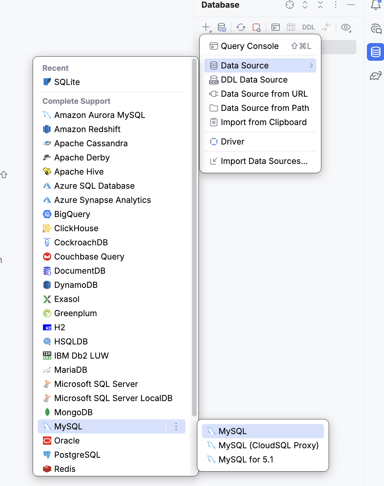
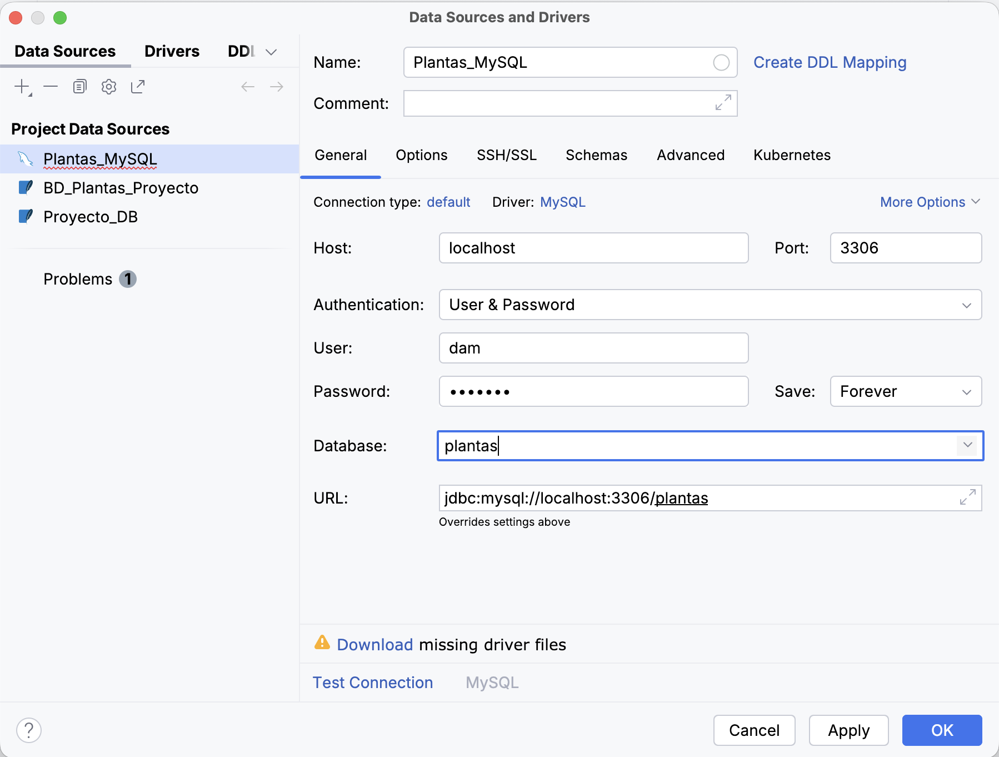
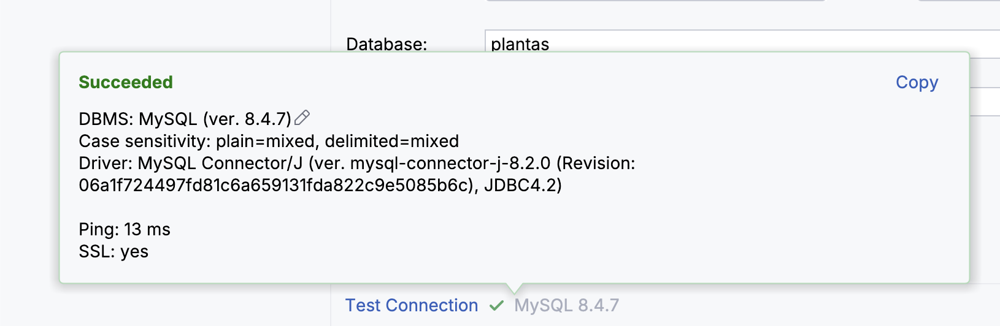
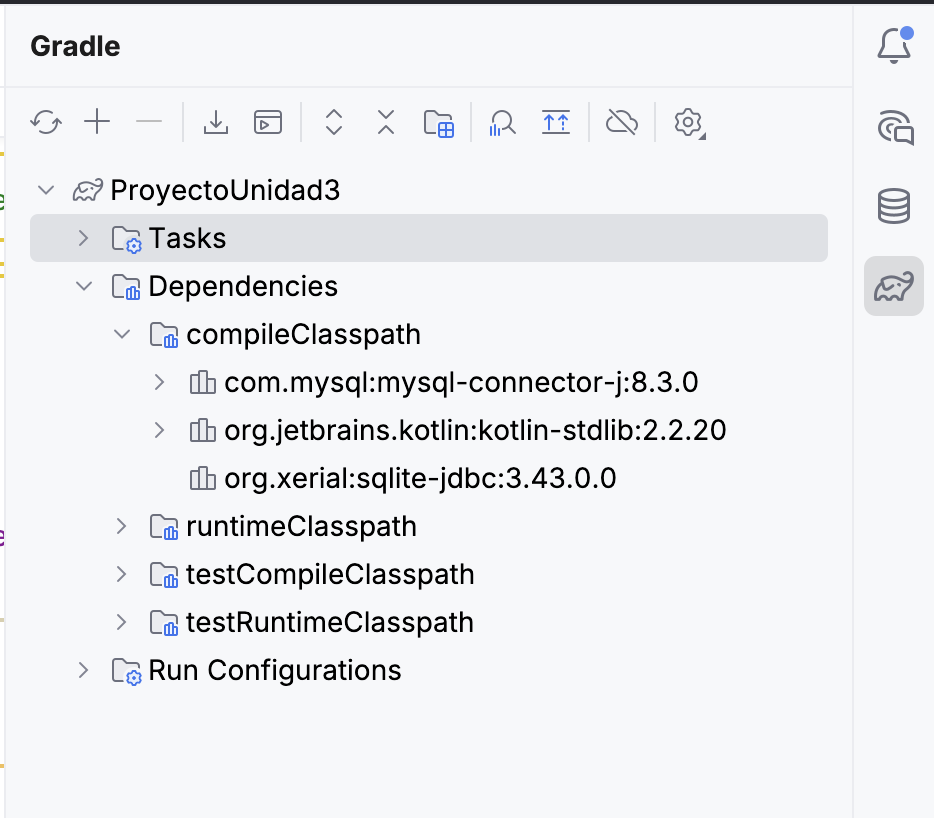

# Evolución a SGBD Cliente-Servidor

Gracias a la buena arquitectura, migrar de SQLite a PostgreSQL, MySQL o cualquier **Sistema Gestor de Bases de Datos** (SGBD) es sencillo. Solo requiere modificar el gestor de conexión.

## Preparación del Entorno. MySQL desde IntelliJ

Para el siguiente paso vamos a configurar y probar una conexión con el **SGBD MySQL**. Instalado en una máquina local. Los pasos a seguir son muy parecidos a los realizamos en la [sección de Preparación del Entorno en la Introducción, con **SQLite**](introduccion.md).

En el lateral derecho de la ventana de IntelliJ, busca y haz clic en la pestaña vertical **Database**. Si no la encuentras, puedes abrirla desde el menú superior: `View > Tool Windows > Database`.

Dentro de la ventana "Database", haz clic en el icono del signo más (`+`) y en el menú desplegable selecciona `Data Source > MySQL`.



Se abrirá una ventana de configuración llamada "Data Sources and Drivers". Aquí debemos indicar a IntelliJ dónde se encuentra nuestro fichero de base de datos.

1. **Nombre (Name):** Asígnale un nombre descriptivo a tu conexión, por ejemplo: `Plantas_MySQL`.
2. **Host:** En este paso debemos indicar la dirección **IP o la URL** donde está alojado nuestro SGBD MySQL. En nuestro caso, `localhost`.
3. **Authentication (User & Password):** Indicaremos las **Credenciales** de acceso a nuestra Base de Datos.
4. **Database:** Debemos escribir el numbre de nuestra Base de Datos.
5. **Descargar Drivers:** Si es la primera vez que usas esta función, IntelliJ te notificará que faltan los drivers necesarios para comunicarse con SQLite. Verás un texto de advertencia con un enlace azul: `Download missing driver files`. Haz clic en él. IntelliJ los descargará e instalará automáticamente en segundo plano.

    La ventana de configuración debería tener un aspecto similar a este:

    

6. Comprobamos que tenemos una conexión abierta y funcionando.

    

## Migración de la BD

Ahora que tenemos configurado el entorno, podemos realizar una importación del **esquema de nuestra base de datos**. Para ello, desde la herramienta, podemos abrirnos una consola SQL (o la herramienta gráfica de creación) e ir añadiendo todas las tablas de nuestra base de datos.

!!! warning "Cuidado"
    El esquema de datos debe ser el mismo que hemos usado, es decir, los mismos **campos** y **tipos de datos.** En la sección de *transacciones* de la unidad, hemos añadido más tablas a nuestro esquema de Base de Datos.

```sql
CREATE TABLE plantas (
    id INTEGER PRIMARY KEY AUTO_INCREMENT,
    nombre_comun VARCHAR(100),
    nombre_cientifico VARCHAR(100),
    stock INTEGER,
    precio REAL
);

CREATE TABLE jardines (
    id_jardin INTEGER PRIMARY KEY AUTO_INCREMENT,
    nombre TEXT
);

CREATE TABLE jardines_plantas (
    id_planta INTEGER,
    id_jardin INTEGER,
    cantidad INTEGER,
    FOREIGN KEY (id_planta) REFERENCES plantas (id),
    FOREIGN KEY (id_jardin) REFERENCES jardines (id_jardin)
);
```

## Modificación del Conector

Como decíamos al inicio, gracias a la **modularidad** que nos ofrece la **arquitectura** de nuestro Proyecto, para poder cambiar el **SGBD** simplemente tendremos que cambiar el archivo `ConexionDB` e indicarle que nuestra conexión se realizará contra *MySQL*.

El primer paso que debemos hacer es **añadir las dependencias** adecuadas a nuestro `build.gradle.kts`.

```kotlin
dependencies {
    testImplementation(kotlin("test"))
    // Para SQLite
    implementation("org.xerial:sqlite-jdbc:3.43.0.0")

    // Para MySQL (coordenadas nuevas desde 8.0.31)
    implementation("com.mysql:mysql-connector-j:8.4.0")
}
```

!!! warning "Importante"
    Si observas que no funciona, prueba a *recargar las dependencias* del Proyecto desde las herramientas de Gradle.



El paso final es modificar el archivo `ConexionBD.kt` de nuestro proyecto. Buscamos la configuració que teníamos con **SQLite** y añadimos la nueva conexión con **MySQL**.

```kotlin

    // Cambia los valores según tu configuración MySQL
    private const val HOST = "localhost" // La IP o dominio de tu SGBD
    private const val PORT = 3306
    private const val DATABASE = "plantas" 
    private const val USER = "USER" // Cambialo por tu usuario
    private const val PASSWORD = "PASSWORD" // Cambialo por tu contraseña

    // URL JDBC para MySQL
    private val url = "jdbc:mysql://$HOST:$PORT/$DATABASE?useSSL=false&serverTimezone=Europe/Madrid"

    fun getConnection(): Connection? {
        return try {
            DriverManager.getConnection(url, USER, PASSWORD)
        } catch (e: SQLException) {
            println("Error al conectar con la base de datos MySQL: ${e.message}")
            null
        }
    }
    // Función de prueba: verificar conexión
    fun testConnection(): Boolean {
        return getConnection()?.use { conn ->
            println("Conexión establecida con éxito")
            true
        } ?: false
    }
```

!!! example "Autoevaluación"

    **Pregunta 10: Gracias al patrón DAO y al objeto `ConexionBD`, el proyecto está diseñado para facilitar el cambio de SGBD. Si se decide migrar de SQLite a MySQL, ¿qué fichero o ficheros del proyecto deben modificarse obligatoriamente?**

    A) Solo `ConexionBD.kt`, cambiando la URL de conexión y las credenciales, y también `build.gradle.kts` para añadir la dependencia del driver de MySQL.

    B) `ConexionBD.kt`, `PlantasDAO.kt` y `Main.kt`, porque cada uno contiene referencias directas al tipo de base de datos.

    C) Solo `build.gradle.kts`, ya que añadir el driver correcto hace que el resto del código funcione automáticamente.

    D) Solo `PlantasDAO.kt`, porque es donde están escritas las consultas SQL que son distintas en MySQL.

    ??? quote "Solución"
        ✅ A) Esta es la ventaja del diseño modular. `ConexionBD.kt` centraliza toda la configuración de la conexión (URL, credenciales, driver). Añadiendo la dependencia del nuevo driver en `build.gradle.kts` y actualizando `ConexionBD.kt`, el resto del proyecto (DAO, Main) sigue funcionando sin cambios.

        ❌ B) `PlantasDAO.kt` usa SQL estándar (SELECT, INSERT, UPDATE, DELETE con PreparedStatement) que es compatible con SQLite y MySQL. `Main.kt` no contiene referencias a la BD. Solo hay que tocar `ConexionBD.kt` y `build.gradle.kts`.

        ❌ C) Añadir el driver no es suficiente. La URL de conexión de SQLite (`jdbc:sqlite:ruta`) es completamente diferente a la de MySQL (`jdbc:mysql://host:puerto/bd`), y MySQL requiere usuario y contraseña. Esos cambios van en `ConexionBD.kt`.

        ❌ D) Las consultas SQL usadas en el proyecto (CRUD básico con PreparedStatement) son compatibles con ambos SGBD sin modificaciones. El único cambio en el DAO podría ser necesario si se usase SQL específico de SQLite (como `AUTOINCREMENT` vs `AUTO_INCREMENT`), pero no es el caso para las operaciones estándar.

## 🎯 Práctica 6: Migración a MySQL o PostgreSQL

!!! warning "🎯 Práctica 6: Migración a MySQL o PostgreSQL"
    1. Instala MySQL o PostgreSQL (preferiblemente mediante Docker, AWS o VirtualBox).
    2. Crea la base de datos `videojuegos` en el nuevo SGBD y ejecuta el script SQL de creación de tus tres tablas (`videojuegos`, `listas`, `listas_videojuegos`) con la misma estructura que en SQLite (recuerda adaptar `AUTOINCREMENT` → `AUTO_INCREMENT` si usas MySQL).
    3. Puebla las tablas con los mismos datos de prueba usados en SQLite.
    4. Modifica únicamente `ConexionBD.kt` con la nueva URL de conexión, usuario y contraseña. Añade también la dependencia del driver en `build.gradle.kts`.
    5. Ejecuta la aplicación. Todas las operaciones del DAO y la lógica de `Main.kt` deben funcionar sin ningún otro cambio.

