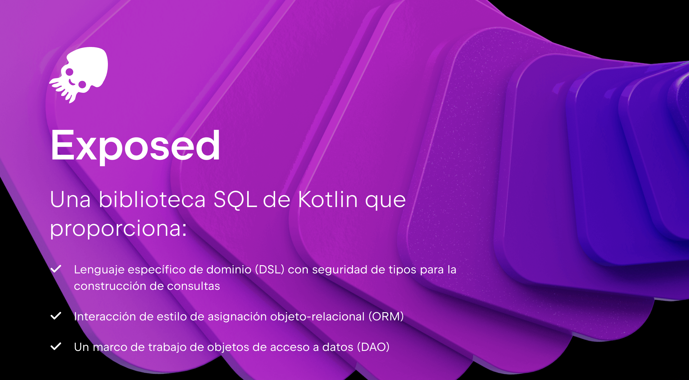

# UD4 — Mapeo Objeto Relacional (ORM)

!!! abstract "Resultado de Aprendizaje"
    - **RA3** - Gestiona la persistencia de los datos mediante herramientas de mapeo objeto-relacional (ORM), desarrollando aplicaciones que la utilizan.

## Objetivos de la Unidad

| # | Objetivo |
| :---: | :--- |
| 1 | Comprender qué es un ORM y las ventajas de Kotlin Exposed frente a JDBC puro |
| 2 | Configurar Exposed en un proyecto Kotlin con Gradle |
| 3 | Definir esquemas de base de datos mediante clases Kotlin (`Table`, `IntIdTable`) |
| 4 | Ejecutar operaciones CRUD utilizando el DSL y el DAO de Exposed |
| 5 | Realizar consultas avanzadas, filtros y joins con Exposed |

---

## Guía de Uso

Estos apuntes están diseñados para un aprendizaje práctico. A lo largo de la unidad se aplicarán los conceptos teóricos para construir, paso a paso, una aplicación completa de gestión de datos.

La temática de la aplicación es de libre elección, pero la estructura y los pasos a seguir serán comunes. Intercaladas con la teoría y los ejemplos, se utilizarán las siguientes cajas de contenido:

!!! success "🔍 Ejecutar y Analizar"
    Contienen fragmentos de código que deben ser ejecutados y comprendidos en detalle. El objetivo es observar su funcionamiento y salida.

!!! warning "🎯 Práctica para Aplicar"
    Indican la necesidad de programar y aplicar los conceptos aprendidos para avanzar en el desarrollo del proyecto personal.

!!! danger "📁 Entrega"
    Marcan los puntos de entrega del trabajo, que serán revisados y calificados por el profesor.

## Instalación y Configuración del Entorno

En esta parte, abordaremos los dos primeros Criterios de Evaluación (CE a y CE b): la instalación de Kotlin Exposed y la configuración de la conexión a la base de datos (BD).

### 1. Introducción: ORM ¿Por qué Exposed?

Antes de empezar, es importante entender por qué usamos un ORM.

Un **ORM (Object-Relational Mapping)** actúa como un traductor entre el mundo de los objetos de Kotlin (clases, instancias) y el mundo de las tablas de la base de datos (filas, columnas). **Exposed** es un ORM ligero y puramente Kotlin, lo que lo hace muy idiomático y fácil de integrar.

**Kotlin Exposed** nos aporta varias ventajas clave:

* **Persistencia Transparente (CRUD):** En lugar de escribir sentencias SQL manuales (`INSERT INTO...`), interactuamos con objetos y el ORM se encarga de generar y ejecutar el SQL por debajo.
* **Manejo del Esquema (DDL):** Permite definir la estructura de las tablas usando clases de Kotlin (`object Usuarios : Table`), lo cual es mucho más natural. Ejemplo: `SchemaUtils.create(Usuarios)` genera la sentencia `CREATE TABLE...`.
* **Abstracción de la Base de Datos:** Los comandos son universales. Si decidimos cambiar de base de datos (ej: de MySQL a PostgreSQL), nuestro código Exposed (el DSL de consultas) **no necesita ser modificado**.
* **Seguridad:** El *Domain Specific Language (DSL)* de Exposed maneja los parámetros de las consultas de forma segura, previniendo inyecciones SQL.

Nuestro objetivo: Escribir código Kotlin en lugar de sentencias SQL crudas, delegando la gestión de la BD al ORM. La [página oficial de Exposed la tienes aquí](https://www.jetbrains.com/es-es/exposed/).



### 2. Instalación de Dependencias

El primer paso es añadir la librería Exposed y el driver JDBC necesario en nuestro fichero `build.gradle.kts`.

Necesitamos tres componentes de Exposed y el driver de **MariaDB** (MySQL), ya que es el que usamos por coherencia con la unidad anterior.

!!! success "🔍 Ejecutar y Analizar: Dependencias de Exposed"
    Abre tu archivo `build.gradle.kts` y asegúrate de que las dependencias de Exposed y MariaDB estén presentes. Recuerda usar el prefijo `implementation`. Tras sincronizar Gradle (icono del elefante en IntelliJ), el panel de dependencias debe mostrar `exposed-core`, `exposed-jdbc` y `exposed-dao` sin errores de compilación.

Fichero: `build.gradle.kts`

```kotlin
dependencies {
    
    val exposedVersion = "0.52.0"

    // 1. Exposed Core: Funcionalidad base
    implementation("org.jetbrains.exposed:exposed-core:${exposedVersion}")
    
    // 2. Exposed JDBC: Conexión y ejecución de consultas
    implementation("org.jetbrains.exposed:exposed-jdbc:${exposedVersion}")
    
    // 3. Exposed DAO: Data Access Object
    implementation("org.jetbrains.exposed:exposed-dao:${exposedVersion}")
    
    // 4. Módulo CLAVE para mapear tipos de fecha (LocalDate, etc.)
    implementation("org.jetbrains.exposed:exposed-java-time:${exposedVersion}")
    
    // 5. Driver JDBC MySQL (Necesario para conectar con nuestro servidor MySQL)
    // Nota: a partir de la versión 8.0.31 las coordenadas cambiaron de grupo
    implementation("com.mysql:mysql-connector-j:8.4.0")

    // Dependencia estándar de Kotlin...
    implementation("org.jetbrains.kotlin:kotlin-stdlib-jdk8")

}
```

### 3. Conexión con la BD

Vamos a preparar ahora nuestro **Objeto de conexión a la Base de Datos**.

Como vimos en la anterior unidad, este objeto nos facilitará gestionar la manera en la que nos conectamos con nuestro servidor. En nuestro caso, seguiremos trabajando con *MySQL*.

Aquí tienes el código de nuestro objeto **ConexionDB** (ubicado en `ConexionDB.kt`), con la configuración de la unidad anterior y la integración de Exposed.

```kotlin
import org.jetbrains.exposed.sql.Database
import org.jetbrains.exposed.sql.SchemaUtils
import org.jetbrains.exposed.sql.transactions.transaction
import org.jetbrains.exposed.sql.Table // Importación necesaria para definir la tabla
import java.sql.DriverManager
import java.sql.SQLException
import java.sql.Connection 

object ConexionDB {
    
    // Configuración de la unidad anterior 
    private const val HOST = "IP_HOST"
    private const val PORT = 3306
    private const val DATABASE = "NOMBRE_BD" // Nombre de nuestra BD
    private const val USER = "USUARIO_BD"
    private const val PASSWORD = "PASSWORD_BD"
    
    // URL JDBC para MySQL, ahora utilizada por Exposed
    private val URL = "jdbc:mysql://$HOST:$PORT/$DATABASE?useSSL=false&serverTimezone=Europe/Madrid"

    // Propiedad para almacenar la instancia de la base de datos de Exposed
    lateinit var db: Database // LA INSTANCIA DE LA CONEXIÓN EXPOSED
    
    /**
     * Intenta establecer la conexión con Exposed e inicializa el esquema de la BD.
     * (CE b: Configuración de la herramienta ORM)
     */
    fun conectar() {
        try {
            // 1. Establece la conexión con la base de datos a través de Exposed
            db = Database.connect(
                url = URL, 
                user = USER, 
                password = PASSWORD
            )
            println("Conexión a MySQL establecida con éxito usando Exposed.")
            
        
         
        } catch (e: Exception) {
            println("Error al conectar o inicializar la base de datos: ${e.message}")
            if (e.message?.contains("Communications link failure") == true) {
                println("   Pista: Asegúrate de que el servidor MySQL está activo y las credenciales son correctas.")
            }
        }
    }
    
    /**
     * Función de prueba para verificar la conexión, manteniendo la estructura de la Unidad 3.
     */
    fun testConexion(): Boolean {
        return try {
            DriverManager.getConnection(URL, USER, PASSWORD)?.use { conn ->
                println("Test: Conexión JDBC pura establecida con éxito.")
                true
            } ?: false
        } catch (e: SQLException) {
            println("Test: Error al conectar con JDBC puro: ${e.message}")
            false
        }
    }
}
```

#### Código Explicado: El Corazón de Exposed

Nuestro conector ha cambiado ligeramente respecto a nuestra anterior versión. Vamos a comentar, paso por paso, las *diferencias*.

```kotlin
lateinit var db: Database 
```

##### ¿Qué es `Database`?

* **Propósito:** `Database` es la clase central de Kotlin Exposed. Una instancia de esta clase representa la conexión y la configuración del *pool* de conexiones a tu base de datos relacional (en nuestro caso, MySQL).
* **Función:** Es la puerta de entrada a todas las operaciones ORM. Cualquier `transaction { ... }` que ejecutemos después deberá saber qué `Database` usar.

##### ¿Por qué `lateinit`?

* **Definición:** `lateinit` es una palabra clave de Kotlin que significa "inicialización tardía" (*late initialization*).
* **Necesidad:** La conexión a la base de datos es una operación de E/S que ocurre **después** de que el objeto `ConexionDB` se construye, específicamente dentro de la función `conectar()`.
* **Solución:** Al usar `lateinit`, le decimos al compilador de Kotlin: "Confía en mí, esta variable será inicializada con un valor válido antes de que sea utilizada por primera vez." Esto evita errores de compilación sin forzarnos a declarar la variable como `null` o inicializarla con un valor falso.

##### Uso dentro de Exposed: La Transacción

La variable `db` se utiliza como argumento obligatorio en los bloques transaccionales:

```kotlin
transaction(ConexionDB.db) {
    // Aquí se ejecutan consultas o DDL
}
```

* Al pasar `ConexionDB.db` a la función `transaction()`, aseguramos que Exposed dirija todas las sentencias SQL (INSERT, SELECT, CREATE TABLE) al servidor MySQL que definimos en la `URL`.

## 🎯 **Práctica 1. Creación del Proyecto y la Base de Datos**

Comenzaremos con nuestro proyecto. Como siempre, preparemos el entorno para poder trabajar durante toda la **Unidad 4** con el **ORM Exposed**.

!!! warning "🎯 Práctica 1. Creación del Proyecto y la Base de Datos"
    1. Crea un nuevo proyecto Kotlin/JVM en IntelliJ y nómbralo **`videojuegos-orm`**.
    2. Actualiza el fichero `build.gradle.kts` con las dependencias de Exposed y el driver MySQL tal como se indica en el ejemplo del profesor.
    3. Crea el archivo `ConexionDB.kt` y configúralo para conectarte a tu servidor MySQL (base de datos `videojuegos`).
    4. Crea el archivo `Main.kt` con la función `main`.
    5. Ejecuta la función `testConexion()` para asegurarte de que tu servidor MySQL está operativo y la conexión es correcta.

!!! example "Autoevaluación"

    **Pregunta 1: ¿Cuál es la diferencia principal entre usar JDBC puro (como en la UD3) y un ORM como Kotlin Exposed?**

    A) JDBC puro solo funciona con SQLite; Exposed solo funciona con MySQL.

    B) Con JDBC puro el programador escribe SQL manualmente y gestiona `ResultSet`; con Exposed se interactúa con objetos Kotlin y el ORM genera el SQL automáticamente.

    C) Exposed elimina la necesidad de un servidor de base de datos porque almacena los datos en memoria RAM.

    D) JDBC puro es más seguro que Exposed porque no usa parámetros variables en las consultas.

    ??? quote "Solución"
        ❌ A) Tanto JDBC puro como Exposed son compatibles con múltiples SGBD (MySQL, PostgreSQL, SQLite, etc.). La elección del SGBD es independiente del mecanismo de acceso.

        ✅ B) Esta es la diferencia fundamental. JDBC requiere escribir `ResultSet`, `PreparedStatement` y SQL manual. Exposed, como ORM, traduce operaciones sobre objetos Kotlin (como `Usuarios.selectAll()`) a sentencias SQL automáticamente, lo que reduce el código repetitivo y los errores.

        ❌ C) Exposed sigue necesitando un SGBD externo (MySQL, PostgreSQL, etc.). Lo que hace es abstraer la comunicación con ese servidor, no eliminarlo.

        ❌ D) Ambos mecanismos ofrecen protección frente a inyección SQL cuando se usan correctamente (PreparedStatement en JDBC, DSL en Exposed). Ninguno es inherentemente más seguro que el otro por defecto.

    **Pregunta 2: En el objeto `ConexionDB`, la variable `db` se declara con `lateinit`. ¿Por qué es necesario usar `lateinit` en lugar de inicializarla directamente?**

    A) Porque `Database` no es un tipo nullable y Kotlin obliga a usar `lateinit` para cualquier objeto de librerías externas.

    B) Porque la conexión a la base de datos es una operación de E/S que ocurre en tiempo de ejecución dentro de `conectar()`, después de que el objeto `ConexionDB` ya ha sido construido; `lateinit` permite declarar la variable sin asignarle valor hasta ese momento.

    C) Porque `lateinit` hace que la conexión sea más rápida al deferirla hasta el primer uso en una consulta.

    D) Porque Kotlin no permite declarar propiedades de tipo `Database` dentro de un `object` sin `lateinit`.

    ??? quote "Solución"
        ❌ A) `lateinit` no es obligatorio para tipos no-nullable de librerías externas. Es una elección del diseño, no una imposición del compilador.

        ✅ B) El `object ConexionDB` se inicializa de forma lazy al primer acceso, pero la variable `db` no puede recibir su valor hasta que se ejecute `conectar()`. `lateinit` le dice al compilador "confía en mí, esta variable tendrá valor antes de usarse" y evita declarar `db` como nullable (`Database?`), lo que obligaría a usar `?.` en cada uso.

        ❌ C) `lateinit` no acelera ninguna operación. Solo pospone la inicialización hasta que el programador la ejecute explícitamente.

        ❌ D) Kotlin sí permite propiedades no-nullable en `object`, siempre que se inicialicen en la declaración o en el bloque `init`. `lateinit` es necesario aquí porque la inicialización ocurre en una función posterior.

