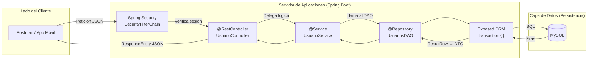

# Arquitectura y Despliegue de la API REST

Llegamos al final del desarrollo. Aquí analizamos la arquitectura completa del proyecto Spring Boot y las formas de empaquetarlo para ejecutarlo de forma independiente.

---

## 1 Arquitectura Final de la Aplicación

La arquitectura es la misma que en Ktor: cliente → controlador → servicio → DAO → BD. La diferencia es que Spring Boot gestiona la inyección de dependencias y el ciclo de vida de los componentes automáticamente.



### Estructura final del proyecto

```text
src/main/kotlin/com/tuproyecto/usuariosapi/
├── UsuariosApiApplication.kt       ← @SpringBootApplication + DataInitializer
├── data/
│   ├── UsuariosTable.kt            ← Definición de tabla (Exposed)
│   └── UsuariosDAO.kt              ← CRUD con transaction { }
├── domain/
│   ├── UsuarioDTO.kt               ← Modelo transferido
│   └── LoginRequest.kt             ← Credenciales de login
├── services/
│   └── UsuarioService.kt           ← Lógica de negocio (@Service)
├── controllers/
│   ├── UsuarioController.kt        ← Endpoints CRUD (@RestController)
│   └── AuthController.kt           ← Login/Logout (@RestController)
└── security/
    └── SecurityConfig.kt           ← Reglas de acceso (SecurityFilterChain)
src/main/resources/
└── application.yml                 ← Configuración BD y servidor
```

---

## 2 Arrancar el Servidor en Desarrollo

La forma más rápida durante el desarrollo es usar el Gradle wrapper:

```bash
# Desde la raíz del proyecto
./gradlew bootRun
```

Verás en la consola algo similar a:

```
  .   ____          _            __ _ _
 /\\ / ___'_ __ _ _(_)_ __  __ _ \ \ \ \
( ( )\___ | '_ | '_| | '_ \/ _` | \ \ \ \
 \\/  ___)| |_)| | | | | || (_| |  ) ) ) )
  '  |____| .__|_| |_|_| |_\__, | / / / /
 =========|_|==============|___/=/_/_/_/

 :: Spring Boot ::               (v3.3.5)

...
✅ Tabla 'usuarios' lista.
Started UsuariosApiApplicationKt in 2.456 seconds (process running for 2.789)
```

La API está disponible en `http://localhost:8080`.

---

## 3 Empaquetado como JAR Ejecutable

Spring Boot genera por defecto un **Fat JAR** (JAR con todo incluido: código + dependencias + Tomcat embebido):

```bash
# Genera el JAR en build/libs/
./gradlew clean bootJar
```

El archivo resultante se llama `usuarios-api-0.0.1-SNAPSHOT.jar` y se ejecuta con:

```bash
java -jar build/libs/usuarios-api-0.0.1-SNAPSHOT.jar
```

No necesita un servidor Tomcat instalado externamente — Tomcat está embebido dentro del JAR.

!!! info "Comparativa Ktor vs Spring Boot — Despliegue"

    | Aspecto | Ktor | Spring Boot |
    |---|---|---|
    | Arranque desarrollo | `./gradlew run` | `./gradlew bootRun` |
    | Fat JAR | `./gradlew buildFatJar` | `./gradlew bootJar` |
    | Distribución | `./gradlew installDist` | (incluido en bootJar) |
    | Servidor embebido | Netty | Tomcat |
    | Ejecución JAR | `java -jar app-all.jar` | `java -jar app.jar` |

---

## 4 Variables de Entorno para Producción

En producción no queremos dejar las credenciales hardcoded en `application.yml`. Spring Boot permite sobreescribir cualquier propiedad con variables de entorno:

```bash
# Ejecutar el JAR con credenciales de producción
java -jar usuarios-api.jar \
  --spring.datasource.url=jdbc:mysql://bd-produccion:3306/usuarios_prod \
  --spring.datasource.username=usuario_prod \
  --spring.datasource.password=contraseña_segura
```

O con variables de entorno de sistema:

```bash
export SPRING_DATASOURCE_URL=jdbc:mysql://bd-produccion:3306/usuarios_prod
export SPRING_DATASOURCE_USERNAME=usuario_prod
export SPRING_DATASOURCE_PASSWORD=contraseña_segura
java -jar usuarios-api.jar
```

---

## 5 Comparativa Ktor vs Spring Boot — Resumen General

| Característica | Ktor | Spring Boot |
|---|---|---|
| Estilo | Funcional / DSL | Basado en anotaciones |
| Configuración inicial | Manual (`Application.kt`) | Automática (`@SpringBootApplication`) |
| Inyección de deps. | Manual (object/companion) | IoC container (@Service, @Repository) |
| Servidor embebido | Netty | Tomcat |
| Seguridad | Plugin `Authentication` + `Sessions` | `SecurityFilterChain` |
| ORM | Exposed (configurado manualmente) | Exposed (via spring-boot-starter) |
| Popularidad | Creciente (Kotlin-first) | Muy extendida (estándar empresarial) |
| Tamaño del JAR | Pequeño (~20 MB) | Mayor (~35-50 MB con Tomcat) |

---

!!! example "Autoevaluación"

    **Pregunta 15: ¿Cuál es la diferencia principal entre `./gradlew bootRun` y `./gradlew bootJar` en Spring Boot?**

    A) `bootRun` compila el código y ejecuta los tests; `bootJar` solo compila sin ejecutar nada.

    B) `bootRun` arranca el servidor directamente desde Gradle para desarrollo (sin generar JAR); `bootJar` genera un JAR ejecutable autónomo con Tomcat embebido, listo para distribuir o desplegar.

    C) `bootJar` requiere un Tomcat externo instalado en el sistema; `bootRun` no necesita nada externo.

    D) Son sinónimos; producen exactamente el mismo resultado.

    ??? quote "Solución"
        ❌ A) `bootRun` no ejecuta tests (para eso es `./gradlew test`). `bootJar` compila y empaqueta, pero no arranca el servidor.

        ✅ B) `bootRun` es el comando de desarrollo: compila y arranca el servidor en la misma sesión de Gradle, ideal para ciclos rápidos de prueba. `bootJar` produce el artefacto desplegable: un JAR que incluye el código compilado, todas las dependencias y Tomcat embebido, que se puede ejecutar en cualquier máquina con `java -jar` sin ninguna otra instalación.

        ❌ C) Tanto `bootRun` como el JAR generado por `bootJar` usan Tomcat embebido. No necesitan instalación externa de Tomcat.

        ❌ D) Producen resultados completamente distintos: uno arranca el servidor en memoria, el otro genera un archivo en disco.

    **Pregunta 16: En la arquitectura final, ¿qué sucede si `application.yml` tiene credenciales incorrectas de MySQL?**

    A) Spring Boot arranca igualmente y el error aparece solo cuando se hace la primera petición a la BD.

    B) Spring Boot falla al arrancar con un error `Communications link failure` o similar porque `exposed-spring-boot-starter` intenta configurar el DataSource en el arranque; si la conexión falla, la aplicación no inicia.

    C) Spring Boot ignora el error de conexión y devuelve listas vacías en todas las peticiones GET.

    D) Spring Boot reintenta la conexión automáticamente cada 30 segundos hasta conseguirla.

    ??? quote "Solución"
        ❌ A) `exposed-spring-boot-starter` configura el `DataSource` durante el contexto de Spring, que se inicializa al arrancar. Un error de conexión en ese momento impide que el contexto se construya correctamente.

        ✅ B) Spring Boot (con `exposed-spring-boot-starter`) valida la conexión al construir el `ApplicationContext`. Si el servidor MySQL no está disponible, las credenciales son incorrectas, o la BD no existe, verás en la consola un error como `HikariPool-1 - Exception during pool initialization` y la aplicación no arrancará. Esto es un comportamiento de *fail-fast*: mejor fallar al inicio que descubrirlo en producción cuando un usuario hace una petición.

        ❌ C) Spring Boot no tiene un modo de "BD opcional". El DataSource es un componente obligatorio cuando está configurado.

        ❌ D) Spring Boot no tiene reintentos automáticos de conexión por defecto. Hay librerías (como Spring Retry) que permiten añadir este comportamiento, pero no es el comportamiento predeterminado.

## 🎯 Práctica 5. Despliegue

!!! warning "🎯 Práctica 5. Despliegue"

    1. Ejecuta `./gradlew clean bootJar`.
    2. Ve a `build/libs/` y ejecuta la aplicación con `java -jar usuarios-api-0.0.1-SNAPSHOT.jar`.
    3. Comprueba en Postman que la API responde (sin IntelliJ abierto).
    4. Observa el tamaño del JAR generado. ¿Por qué es mayor que un JAR Ktor equivalente?
    5. **Misión Final:** Pasa el JAR a un compañero que tenga MySQL con la misma BD. Comprueba si puede arrancar tu API.
