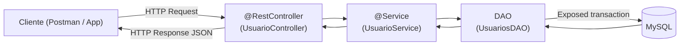

# Introducción a Spring Boot y las API REST

## 1 ¿Qué es Spring Boot?

**Spring Boot** es un framework para crear aplicaciones backend en Kotlin/Java que **elimina la configuración manual** típica de Spring Framework. Su principio fundamental es *Convention over Configuration*: con unas pocas dependencias y un archivo de propiedades ya tienes un servidor listo para producción.

A diferencia de Ktor (que es un framework minimalista de JetBrains donde defines todo de forma explícita y funcional), Spring Boot usa **anotaciones** para declarar comportamientos. Esta es la diferencia clave:

| Aspecto | Ktor | Spring Boot |
|---|---|---|
| Estilo | Funcional / DSL | Basado en anotaciones |
| Servidor | Netty (embebido) | Tomcat (embebido) |
| Rutas | `routing { get("/path") { } }` | `@GetMapping("/path")` |
| Inyección de deps. | Manual / parámetros | `@Autowired` / constructor |
| Configuración | `Application.kt` + plugins | `application.yml` + anotaciones |
| Curva de aprendizaje | Suave | Algo más pronunciada |
| Uso en la industria | Creciente (startups, Kotlin-first) | Muy extendido (empresarial) |

Ambos sirven para construir exactamente **la misma API REST**; la diferencia está en el estilo de código.

## 2 ¿Qué construiremos?

Seguiremos el mismo objetivo que en la versión con Ktor: una **API REST completa para gestionar Usuarios** con:

- Base de datos **MySQL** y mapeo con **Exposed ORM**.
- Arquitectura en capas: **Datos → Servicio → Controlador**.
- **Autenticación** con Spring Security.
- Pruebas con **Postman**.

El modelo de datos es idéntico:

```kotlin
data class UsuarioDTO(
    val id: Int?,
    val nombre: String,
    val mail: String,
    val password: String,
    val fechaNacimiento: LocalDate
)
```

## 3 Arquitectura de la aplicación



La única diferencia con la versión Ktor es que ahora la capa de controlador usa `@RestController` en lugar de `routing { }`.

## 4 Endpoints que implementaremos

| Método | URL | Descripción | Código HTTP |
|---|---|---|---|
| `GET` | `/usuarios` | Listar todos | 200 OK |
| `GET` | `/usuarios/{id}` | Buscar por ID | 200 / 404 |
| `POST` | `/usuarios` | Crear nuevo | 201 Created |
| `PUT` | `/usuarios/{id}` | Actualizar | 200 / 404 |
| `DELETE` | `/usuarios/{id}` | Eliminar | 200 / 404 |
| `POST` | `/login` | Iniciar sesión | 200 / 401 |
| `POST` | `/logout` | Cerrar sesión | 200 |

---

!!! example "Autoevaluación"

    **Pregunta 1: ¿Cuál es la principal diferencia de enfoque entre Ktor y Spring Boot para definir rutas REST?**

    A) Ktor usa MySQL y Spring Boot usa PostgreSQL por defecto.

    B) Ktor define las rutas de forma funcional dentro de bloques `routing { }`, mientras que Spring Boot las declara con anotaciones como `@GetMapping` sobre métodos de una clase `@RestController`.

    C) Spring Boot solo soporta JSON; Ktor soporta cualquier formato de datos.

    D) Ktor requiere un servidor externo (Tomcat); Spring Boot usa Netty embebido.

    ??? quote "Solución"
        ❌ A) El tipo de base de datos es independiente del framework. Ambos son compatibles con MySQL, PostgreSQL y cualquier otra BD.

        ✅ B) Esta es la diferencia fundamental. Ktor sigue un estilo funcional/DSL donde las rutas son lambdas dentro de un bloque `routing`. Spring Boot usa el patrón MVC clásico: una clase anotada con `@RestController` donde cada método anotado con `@GetMapping`, `@PostMapping`, etc., responde a una ruta concreta. El resultado (la API REST) es el mismo.

        ❌ C) Ambos frameworks soportan JSON (y otros formatos) mediante librerías de serialización.

        ❌ D) Es al revés: Ktor usa Netty como servidor embebido y Spring Boot usa Tomcat embebido (aunque también puede configurarse con Netty o Jetty).

    **Pregunta 2: En la arquitectura de la UD5, ¿qué responsabilidad tiene la capa `@Service`?**

    A) Conectarse directamente a la base de datos y ejecutar las consultas SQL.

    B) Recibir las peticiones HTTP del cliente y devolver las respuestas.

    C) Contener la lógica de negocio (validaciones, reglas, coordinación entre capas) actuando como intermediario entre el Controlador y el DAO.

    D) Gestionar la autenticación y autorización de los usuarios.

    ??? quote "Solución"
        ❌ A) Esa es la responsabilidad del DAO (Data Access Object), que usa Exposed para interactuar con la BD.

        ❌ B) Esa es la responsabilidad del `@RestController`, que maneja las peticiones y respuestas HTTP.

        ✅ C) La capa `@Service` es el lugar donde vive la lógica de negocio: validar que un email no esté duplicado antes de insertar, aplicar reglas de dominio, combinar llamadas a varios DAOs, etc. El Controlador delega en el Servicio; el Servicio delega en el DAO. Esta separación hace el código más limpio, testeable y mantenible.

        ❌ D) La autenticación y autorización la gestiona Spring Security mediante la configuración del `SecurityFilterChain`.
