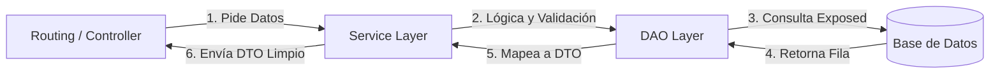
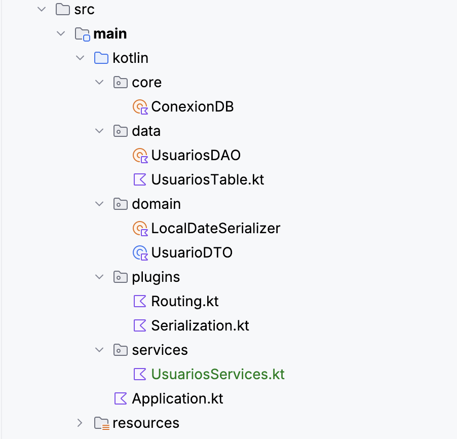

# Capa de Dominio y Servicios

En los apartados anteriores hemos construido los cimientos (Base de Datos) y las herramientas de traducción (JSON). Ahora vamos a crear la **Capa de Servicio**, el lugar donde reside la lógica de nuestra aplicación.

## 1 La Necesidad de una Capa de Servicio

¿Por qué no llamar al `UsuariosDAO` directamente desde las rutas de Ktor? Aunque en aplicaciones muy pequeñas funciona, en entornos profesionales usamos una capa intermedia llamada **Service** por tres razones clave:

1. **Abstracción:** Si mañana cambiamos el DAO o usamos dos bases de datos distintas, el controlador (las rutas) no tiene por qué enterarse.
2. **Lógica de Negocio:** El DAO solo sabe hacer CRUD. El Servicio sabe, por ejemplo, que no se puede registrar a un usuario si el email ya existe o si es menor de edad.
3. **Seguridad:** Podemos filtrar datos sensibles o transformar objetos antes de que salgan a la red.

### Flujo de Comunicación

El siguiente gráfico representa cómo interactúan los componentes en nuestra arquitectura modular:



## 2 Implementación del Servicio: `UsuariosService.kt`

El Servicio es el "empleado" que recibe órdenes del Controlador y utiliza al "especialista" (DAO) para ejecutarlas.

!!! success "🔍 Ejecutar y Analizar"
    Crea el archivo `UsuariosService.kt` en la carpeta `services`. Observa cómo esta capa gestiona la lógica antes de tocar la base de datos.

```kotlin
package com.tu.proyecto.services

import com.tu.proyecto.data.UsuariosDAO
import com.tu.proyecto.domain.UsuarioDTO

/**
 * Capa de Servicio: Aquí reside la lógica de negocio.
 * Se encarga de validar datos y coordinar las llamadas al DAO.
 */
object UsuariosService {

    /**
     * Obtiene todos los usuarios. Podría aplicar filtros o lógica adicional.
     */
    fun listarUsuarios(): List<UsuarioDTO> {
        return UsuariosDAO.seleccionarTodos()
    }

    /**
     * Busca un usuario por ID.
     */
    fun buscarPorId(id: Int): UsuarioDTO? {
        return UsuariosDAO.seleccionarPorId(id)
    }

    /**
     * Lógica para crear un usuario.
     * Aquí podríamos verificar si el email ya existe antes de insertar.
     */
    fun registrarUsuario(usuario: UsuarioDTO): Int {
        // Ejemplo de regla de negocio: Comprobar si el mail ya está en la lista
        val existe = UsuariosDAO.seleccionarTodos().any { it.mail == usuario.mail }
        if (existe) return -1
        
        return UsuariosDAO.insertar(usuario)
    }

    /**
     * Actualiza un usuario existente.
     */
    fun actualizarUsuario(id: Int, usuario: UsuarioDTO): Int {
        return UsuariosDAO.actualizar(id, usuario)
    }

    /**
     * Elimina un usuario.
     */
    fun borrarUsuario(id: Int): Int {
        return UsuariosDAO.eliminar(id)
    }
}
```

!!! warning "Recuerda"
    **TODA** la lógica de negocio (reglas de validación, seguridad de datos, búsquedas previas, etc.) se realiza en la capa de Servicio (en el Controlador) y **no en el DAO**.

## 3 El Contrato de API: DTOs Serializables

Como vimos, el **UsuarioDTO** es nuestro contrato. Es la promesa de cómo se ven los datos tanto para el cliente (Frontend) como para el servidor.

!!! success "🔍 Recordatorio del Modelo de Dominio"
    Asegúrate de que tu `UsuarioDTO.kt` sea el único objeto que viaja entre el Servicio y el Controlador. Esto mantiene la **Capa de Datos** (Tablas y Rows) totalmente oculta para el exterior.

## 4 Estructura de Carpetas Actualizada

Con la incorporación de los servicios, nuestra arquitectura modular queda así:

```text
src/main/kotlin/com/tu.proyecto/
├── core/
│   └── ConexionDB.kt    
├── data/
│   ├── UsuariosTable.kt 
│   └── UsuariosDAO.kt   
├── domain/              // CAPA DE DOMINIO
│   ├── UsuarioDTO.kt    
│   └── LocalDateSerializer.kt 
├── services/            // CAPA DE SERVICIO (Lógica de Negocio)
│   └── UsuariosService.kt   
├── plugins/
│   ├── Serialization.kt 
│   └── Routing.kt       
└── Application.kt       
```

---

!!! example "Autoevaluación"

    **Pregunta 9: En `UsuariosService`, la función `registrarUsuario` comprueba si el email ya existe antes de insertar. ¿Por qué se realiza esta validación en el Servicio y no en el DAO?**

    A) Porque el DAO no tiene acceso a la función `seleccionarTodos()` necesaria para la comprobación.

    B) Porque la lógica de negocio (reglas sobre qué se permite o no) pertenece al Servicio; el DAO solo debe ejecutar operaciones de BD sin tomar decisiones sobre si deben realizarse.

    C) Por razones de rendimiento: llamar al DAO desde el propio DAO generaría un bucle infinito.

    D) Porque la anotación `@Serializable` en el DTO impide que el DAO lo compare directamente.

    ??? quote "Solución"
        ❌ A) El DAO sí tiene acceso a `seleccionarTodos()` porque es un método del mismo objeto. La razón de hacer la comprobación en el Servicio no es técnica, sino arquitectónica.

        ✅ B) La separación de responsabilidades es el principio clave aquí. El DAO es un especialista en persistencia (INSERT, SELECT, UPDATE, DELETE). El Servicio es quien aplica las reglas de negocio ("¿debería permitirse esta operación?"). Mezclar ambas responsabilidades en el DAO lo haría difícil de reutilizar y de testear.

        ❌ C) No hay ningún riesgo de bucle infinito al llamar a métodos del mismo objeto desde sí mismo. El flujo es lineal.

        ❌ D) `@Serializable` es una anotación de Kotlin que no restringe las operaciones de comparación. Los objetos `UsuarioDTO` se pueden comparar normalmente con `.any { it.mail == ... }`.

    **Pregunta 10: ¿Qué valor devuelve `registrarUsuario` cuando el email ya existe en la base de datos?**

    A) `0`, indicando que se insertaron 0 filas.

    B) `null`, porque no se pudo crear el usuario.

    C) `-1`, como código de error personalizado que el Controlador interpreta para devolver 409 Conflict al cliente.

    D) Lanza una `IllegalArgumentException` con el mensaje "El email ya existe".

    ??? quote "Solución"
        ❌ A) El valor `0` podría confundirse con un ID válido en algunos sistemas. El diseño de esta función usa `-1` como centinela para distinguir el error del éxito.

        ❌ B) La función devuelve `Int`, no `Int?`. Devolver `null` requeriría cambiar el tipo de retorno a `Int?` y añadir comprobaciones en el Controlador.

        ✅ C) Devolver `-1` es la convención elegida en este diseño. El Controlador interpreta `nuevoId == -1` como conflicto y responde con `HttpStatusCode.Conflict` (409). Es un contrato claro entre las dos capas.

        ❌ D) Lanzar una excepción para un caso previsto (email duplicado) no es buena práctica en este diseño. Las excepciones se reservan para errores inesperados; los casos de negocio se comunican mediante valores de retorno o sealed classes.

## 🎯 Práctica 3. Creando la capa de Servicio

!!! warning "🎯 Práctica 3. Creando la capa de Servicio"

    1. Crea el paquete `services` en tu proyecto.
    2. Implementa el objeto `UsuariosService` siguiendo el ejemplo anterior.
    3. Reflexiona: ¿Qué otra regla de negocio podrías añadir? (Ej: Validar que el nombre no esté vacío o que la contraseña tenga una longitud mínima).

Llegados a este punto, el proyecto debe ser similar a esto:

