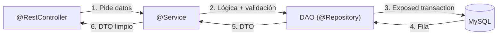

# Capa de Dominio y Servicios

La capa de servicio es la misma en Spring Boot que en Ktor: contiene la **lógica de negocio** y actúa de intermediario entre el Controlador y el DAO. Lo que cambia es que en Spring Boot usamos la anotación `@Service` para que Spring la gestione automáticamente.

## 1 La Necesidad de una Capa de Servicio

El patrón es exactamente igual al de la versión Ktor:



La diferencia con Ktor es que aquí el Controlador no instancia el Servicio manualmente: Spring se encarga de **inyectarlo** gracias a `@Service` y la inyección por constructor.

## 2 Implementación: `UsuarioService.kt`

!!! success "🔍 Ejecutar y Analizar"
    Crea `services/UsuarioService.kt`. Observa la anotación `@Service` y cómo se inyecta `UsuariosDAO` por constructor.

```kotlin
package com.tuproyecto.usuariosapi.services

import com.tuproyecto.usuariosapi.data.UsuariosDAO
import com.tuproyecto.usuariosapi.domain.UsuarioDTO
import org.springframework.stereotype.Service

@Service
class UsuarioService {

    /**
     * Devuelve la lista completa de usuarios.
     */
    fun listarUsuarios(): List<UsuarioDTO> = UsuariosDAO.seleccionarTodos()

    /**
     * Busca un usuario por ID. Devuelve null si no existe.
     */
    fun buscarPorId(id: Int): UsuarioDTO? = UsuariosDAO.seleccionarPorId(id)

    /**
     * Lógica para crear un usuario.
     * Comprueba que el mail no esté ya registrado.
     * Devuelve el ID del nuevo usuario o -1 si el mail ya existe.
     */
    fun registrarUsuario(usuario: UsuarioDTO): Int {
        val existe = UsuariosDAO.seleccionarTodos().any { it.mail == usuario.mail }
        if (existe) return -1
        return UsuariosDAO.insertar(usuario)
    }

    /**
     * Actualiza los datos de un usuario existente.
     * Devuelve el número de filas modificadas (0 si no existe).
     */
    fun actualizarUsuario(id: Int, usuario: UsuarioDTO): Int =
        UsuariosDAO.actualizar(id, usuario)

    /**
     * Elimina un usuario por ID.
     * Devuelve el número de filas eliminadas (0 si no existe).
     */
    fun borrarUsuario(id: Int): Int = UsuariosDAO.eliminar(id)
}
```

!!! warning "Recuerda"
    **Toda** la lógica de negocio (reglas de validación, comprobaciones previas, etc.) vive en el `@Service`, **nunca** en el DAO ni en el Controlador. El DAO solo sabe hacer CRUD; el Controlador solo sabe recibir y responder peticiones HTTP.

## 3 Inyección de Dependencias en Spring Boot

En Spring Boot la **inyección de dependencias** (IoC) funciona automáticamente. Cuando marcas una clase con `@Service`, `@Repository` o `@Component`, Spring crea una instancia única (*singleton*) y la inyecta donde sea necesaria.

La forma recomendada es **inyección por constructor**:

```kotlin
// En el controlador (lo veremos en la siguiente sección):
@RestController
class UsuarioController(
    private val service: UsuarioService  // ← Spring inyecta aquí automáticamente
) { ... }
```

No hace falta instanciar `UsuarioService()` manualmente; Spring lo hace por nosotros.

!!! info "Comparativa Ktor vs Spring Boot — Service Layer"

    | Aspecto | Ktor | Spring Boot |
    |---|---|---|
    | Definición | `object UsuariosService { }` | `@Service class UsuarioService { }` |
    | Instanciación | Manual (`UsuariosService`) | Automática por IoC container |
    | Inyección en rutas | Llamada directa al object | Inyección por constructor |
    | Lógica de negocio | Igual | Igual |

    El código de la lógica es prácticamente idéntico. La diferencia está en cómo Spring gestiona el ciclo de vida del objeto.

## 4 Estructura de Carpetas Actualizada

```text
src/main/kotlin/com/tuproyecto/usuariosapi/
├── UsuariosApiApplication.kt
├── data/
│   ├── UsuariosTable.kt
│   └── UsuariosDAO.kt
├── domain/
│   └── UsuarioDTO.kt
├── services/
│   └── UsuarioService.kt       ← NUEVA
└── controllers/                ← (próxima sección)
```

---

## 🎯 Práctica 2. Creando la capa de Servicio

!!! warning "🎯 Práctica 2. Creando la capa de Servicio"

    1. Crea el paquete `services` y el archivo `UsuarioService.kt`.
    2. Implementa los 5 métodos del servicio siguiendo el ejemplo.
    3. Reflexiona: ¿qué otra regla de negocio podrías añadir? (Ej: que el nombre no esté vacío, o que la fecha de nacimiento sea válida).

---

!!! example "Autoevaluación"

    **Pregunta 9: ¿Qué ventaja aporta la anotación `@Service` frente a no usarla?**

    A) Permite que la clase se ejecute más rápido al estar optimizada por el compilador de Spring.

    B) Registra la clase en el contenedor de IoC de Spring, permitiendo que sea inyectada automáticamente en otros componentes y activando funcionalidades como gestión de transacciones declarativas.

    C) Hace que todos los métodos de la clase sean `public` y `final` automáticamente.

    D) Es solo una anotación decorativa para documentación; no tiene efecto en tiempo de ejecución.

    ??? quote "Solución"
        ❌ A) Spring no optimiza el bytecode por el tipo de anotación. El rendimiento de la clase depende del código que contiene, no de si tiene `@Service`.

        ✅ B) `@Service` registra la clase en el *Application Context* de Spring (el contenedor IoC). Esto significa que Spring crea una única instancia (*singleton*) de la clase al arrancar y la inyecta automáticamente en cualquier componente que la declare como dependencia (p. ej., en el constructor del `@RestController`). Además, al ser un componente Spring, puede beneficiarse de funcionalidades como `@Transactional` para gestión declarativa de transacciones.

        ❌ C) `@Service` no modifica la visibilidad de los métodos. En Kotlin los métodos son `public` por defecto, y `@Service` no añade `final` (de hecho, `kotlin("plugin.spring")` hace lo contrario: abre las clases para que Spring pueda hacer proxies).

        ❌ D) `@Service` tiene efecto real en tiempo de ejecución: Spring la escanea durante el arranque (`@ComponentScan`) y crea el bean correspondiente.

    **Pregunta 10: En `UsuarioService`, `registrarUsuario` devuelve `-1` cuando el mail ya existe. ¿Podría lanzar una excepción en su lugar?**

    A) No, Spring Boot no permite lanzar excepciones desde un `@Service`.

    B) Sí, y sería incluso más idiomático en Spring Boot. Podría lanzar una excepción personalizada que el Controlador captura con `@ExceptionHandler` o que Spring convierte automáticamente en una respuesta HTTP con `@ResponseStatus`.

    C) Solo se pueden lanzar `RuntimeException`; las excepciones propias no están permitidas en Spring Boot.

    D) Sí, pero solo si la clase está anotada con `@Transactional`.

    ??? quote "Solución"
        ❌ A) Spring Boot no tiene ninguna restricción sobre lanzar excepciones en un `@Service`. Es perfectamente válido y habitual.

        ✅ B) En aplicaciones Spring Boot de producción es común usar excepciones personalizadas para casos de error de negocio. Por ejemplo:
        ```kotlin
        class MailDuplicadoException(mail: String) :
            RuntimeException("El email $mail ya está registrado")
        ```
        Anotada con `@ResponseStatus(HttpStatus.CONFLICT)`, Spring la convierte automáticamente en un 409. Los controladores con `@ExceptionHandler` permiten centralizar el manejo de errores. El enfoque con valor de retorno `-1` es más simple para introducir el concepto.

        ❌ C) En Kotlin puedes crear y lanzar cualquier clase que herede de `Throwable` (o `Exception`, `RuntimeException`, etc.). No hay restricciones de tipos en Spring Boot.

        ❌ D) `@Transactional` controla el contexto de transacción de BD, no la capacidad de lanzar excepciones.
