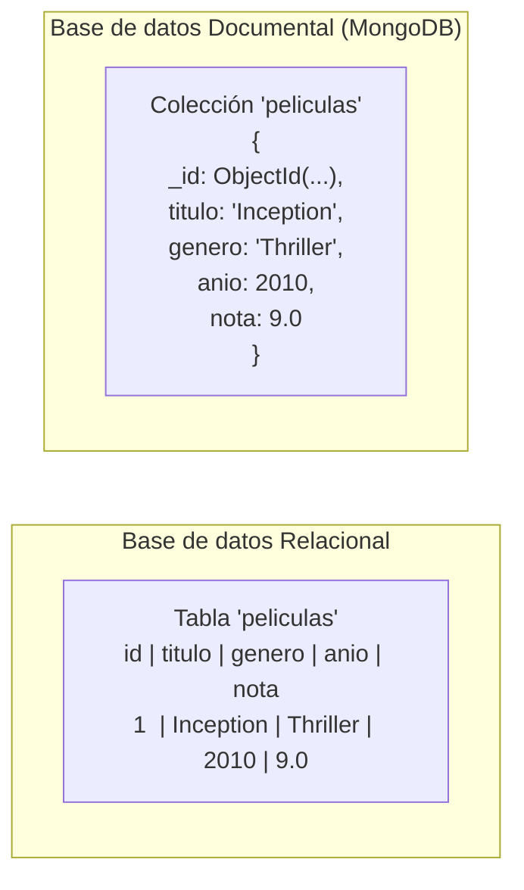
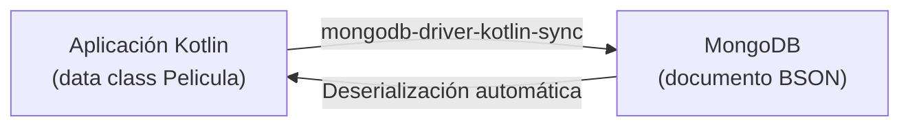

# Introducción a las Bases de Datos Documentales

!!! abstract "Resultado de Aprendizaje 5 (RA5)"

    **Desarrolla aplicaciones que gestionan la información almacenada en bases de datos documentales nativas evaluando y utilizando clases específicas.**

    Esta unidad cubre los criterios de evaluación asociados al RA5:

    - CE5a: Se han identificado las características de las bases de datos documentales.
    - CE5b: Se han clasificado los tipos de BSON (Binary JSON) y sus equivalentes en Kotlin.
    - CE5c: Se ha establecido una conexión con una base de datos documental desde Kotlin.
    - CE5d: Se han realizado operaciones CRUD sobre colecciones de documentos.
    - CE5e: Se han utilizado filtros y proyecciones para consultar colecciones.

## 1 ¿Qué es una Base de Datos Documental?

Hasta ahora hemos trabajado con bases de datos **relacionales** (SQLite, MySQL) donde la información se organiza en tablas con filas y columnas, y los datos se relacionan mediante claves foráneas.

Una **base de datos documental** almacena la información como **documentos** independientes, en lugar de filas en una tabla. Cada documento es una unidad autocontenida que puede tener su propia estructura.

### El Modelo de Datos de MongoDB

MongoDB almacena documentos en formato **BSON** (Binary JSON), que es una representación binaria de JSON con tipos de datos adicionales.

Un documento de MongoDB equivale, aproximadamente, a una fila de una tabla relacional, pero con una diferencia clave: **no es necesario que todos los documentos de una colección tengan la misma estructura**.



### Vocabulario equivalente

| Concepto Relacional | Concepto MongoDB |
|---|---|
| Base de datos | Base de datos |
| Tabla | Colección (*Collection*) |
| Fila | Documento (*Document*) |
| Columna | Campo (*Field*) |
| Clave primaria | `_id` (ObjectId) |
| Clave foránea | Referencia o documento embebido |
| SQL | MQL (MongoDB Query Language) |

## 2 ¿Cuándo usar una Base de Datos Documental?

!!! info "MongoDB no reemplaza a SQL — son herramientas distintas"

    MongoDB no es "mejor" ni "peor" que MySQL. Cada modelo tiene sus puntos fuertes:

    - **SQL** → datos muy estructurados, relaciones complejas, transacciones estrictas (banca, ERP).
    - **MongoDB** → datos semiestructurados o variables, escalabilidad horizontal, desarrollo ágil (catálogos, redes sociales, IoT, logs).

### Ventajas del modelo documental

- **Esquema flexible**: los documentos pueden tener campos distintos sin alterar la colección.
- **Lecturas rápidas**: los datos relacionados se pueden embeber en un mismo documento (sin JOINs).
- **Escalabilidad horizontal**: MongoDB escala distribuyendo datos en múltiples servidores (*sharding*).
- **Formato nativo JSON/BSON**: ideal para APIs REST y aplicaciones web modernas.

### Ejemplo de documento embebido

En un modelo relacional necesitaríamos dos tablas para representar una película con sus directores. En MongoDB podemos embeberlo todo en un único documento:

```json
{
  "_id": { "$oid": "507f1f77bcf86cd799439011" },
  "titulo": "Inception",
  "genero": "Thriller",
  "anio": 2010,
  "nota": 9.0,
  "directores": ["Christopher Nolan"],
  "reparto": ["Leonardo DiCaprio", "Joseph Gordon-Levitt"]
}
```

## 3 MongoDB y Kotlin

Para conectar Kotlin con MongoDB usaremos el **MongoDB Kotlin Sync Driver** (`mongodb-driver-kotlin-sync`), el driver oficial de MongoDB para aplicaciones Kotlin síncronas en el lado del servidor.

Este driver utiliza **data classes** de Kotlin como modelo de datos, lo que hace que la integración sea muy natural.



!!! info "Driver síncrono vs. driver de corrutinas"
    MongoDB ofrece dos drivers para Kotlin:

    - `mongodb-driver-kotlin-sync` → **síncrono**, el que usaremos en este módulo. Más sencillo y compatible con el estilo de programación que hemos visto.
    - `mongodb-driver-kotlin-coroutine` → asíncrono con corrutinas, indicado para aplicaciones Ktor en producción.

---

!!! example "Autoevaluación"

    **Pregunta 1: ¿Cuál es la diferencia fundamental entre una tabla SQL y una colección de MongoDB?**

    A) En MongoDB las colecciones no pueden contener más de 1.000 documentos.

    B) En una tabla SQL todos los registros tienen la misma estructura de columnas; en una colección de MongoDB los documentos pueden tener campos distintos entre sí.

    C) Las colecciones de MongoDB solo pueden almacenar texto; para números se deben usar tablas SQL.

    D) No hay ninguna diferencia: colección y tabla son sinónimos exactos en todos los aspectos.

    ??? quote "Solución"
        ❌ A) No existe ese límite. MongoDB puede almacenar millones (o miles de millones) de documentos en una colección.

        ✅ B) Esta es la diferencia clave del modelo documental. Una tabla SQL impone un esquema rígido (todas las filas deben tener las mismas columnas), mientras que MongoDB permite esquemas flexibles donde cada documento puede incluir o excluir campos. Esto facilita el desarrollo ágil y la evolución del modelo de datos.

        ❌ C) BSON (el formato de MongoDB) soporta todos los tipos de datos: String, Int, Double, Boolean, Date, Array, Document anidado, ObjectId, etc.

        ❌ D) Aunque son conceptos análogos, no son idénticos: una tabla impone un esquema fijo mientras que una colección no lo hace.

    **Pregunta 2: ¿Qué es el `_id` en un documento de MongoDB?**

    A) Un campo opcional que el desarrollador puede incluir o no en sus documentos.

    B) El campo de clave primaria que MongoDB genera automáticamente como `ObjectId` si no se especifica, garantizando la unicidad de cada documento.

    C) El número de fila del documento dentro de la colección, análogo al autoincrement de SQL.

    D) El nombre de usuario del desarrollador que creó el documento.

    ??? quote "Solución"
        ❌ A) El campo `_id` no es opcional. MongoDB exige que todos los documentos tengan un `_id`. Si el desarrollador no lo proporciona, MongoDB lo genera automáticamente.

        ✅ B) El `_id` es el identificador único de cada documento. Por defecto MongoDB genera un `ObjectId` (12 bytes que codifican timestamp, identificador de máquina y contador). El desarrollador puede proporcionar su propio `_id` de cualquier tipo, pero debe ser único en la colección.

        ❌ C) `ObjectId` no es un número de fila secuencial como el autoincrement SQL. Es un identificador único global que incluye información de tiempo y máquina. No es predecible ni secuencial de la misma forma.

        ❌ D) El `_id` no tiene ninguna relación con el usuario que creó el documento.
